# Proof of progress

What was built, what broke along the way, and how it was fixed. Everything below was done on 2026-10-22. Screenshots are from the running app. Numbers come from manual runs against the live Gemini API unless marked otherwise.

## Where it stands

| Area | Status |
|---|---|
| Test 1: profile → shortlist → personalised application | Passed in the browser |
| Test 2: personalised application with chance of being shortlisted | Passed in the browser |
| Test 3: asks follow-up questions and uses the answers | Passed in the browser (thin profile, gibberish and "Skip" also checked) |
| Multi-page journey: intake, profile, what-if, 3-4 drafts, chat, scholarships, alumni | Built. Each page was opened and used in a desktop browser |
| **Version 4:** 6-step intake, profile strength score, strengths and gaps, cost breakdown and compare table, funding range slider, plan checklist, calendar file, Word and PDF export, share link | Built. Each was used in a desktop browser against the live AI (see the version 4 screenshots). PDF print, a real calendar app and Word itself were not opened |
| Version 4 on a phone | Every page measured at 375 px wide: no sideways scrolling. Not tested on a real phone |
| Google Search grounding with source links | Code and unit tests only. **Not run for real**: Google refused the search tool on the free key. Off by default, with "verify links" as the fallback |
| Loan and debt calculator | Built, tested against published loan-table values |
| Plain-code tests (`npm test`) | 9 test files, all passing, no key needed |
| `tsc`, lint | Clean |
| Deployed prototype | Version 3 is live. **Version 4 is not deployed yet**, and the live site has no AI key set until the owner adds `GEMINI_API_KEY` in Vercel |

## Screenshots

| | |
|---|---|
| **Intake: money, risk, scholarship and loan.** Step 3 of 5 of the guided form. | 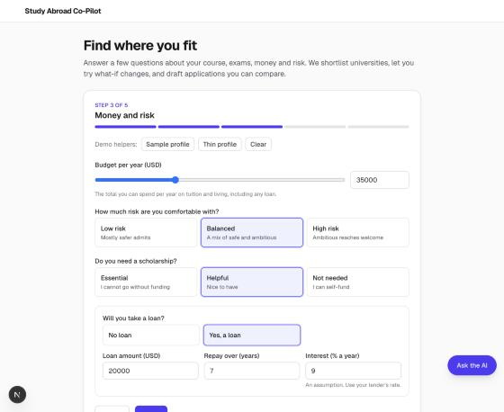 |
| **Profile and loan calculator.** Every answer is listed. The loan numbers are plain maths (USD 20,000 at 9% over 7 years is about USD 322 a month, checked independently). | 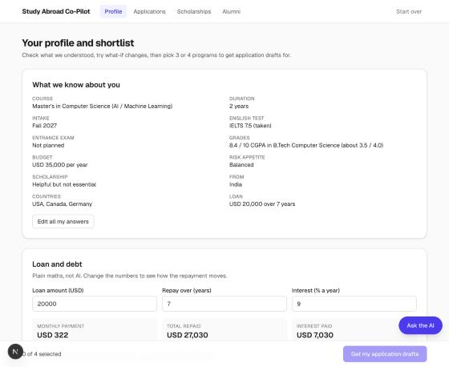 |
| **A bug caught on screen.** The what-if rebuilt the whole list, swapped four programs, and one reason contains the AI's own second-guessing ("wait, the prompt says..."). This led to a redesign (see below). | 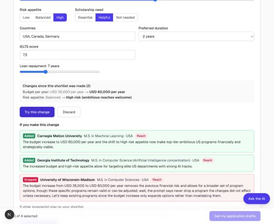 |
| **Draft comparison.** Three programs side by side: chance, statement length, blanks to fill, numbers and wording to check. | 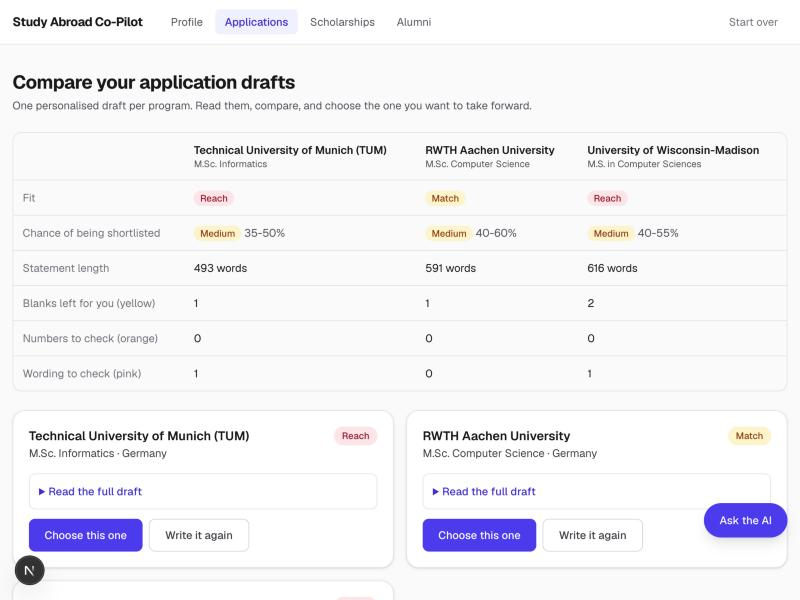 |
| **One draft opened.** Chance with reasons, and the legend for yellow (blank), orange (number you never gave) and pink (wording you never used). | 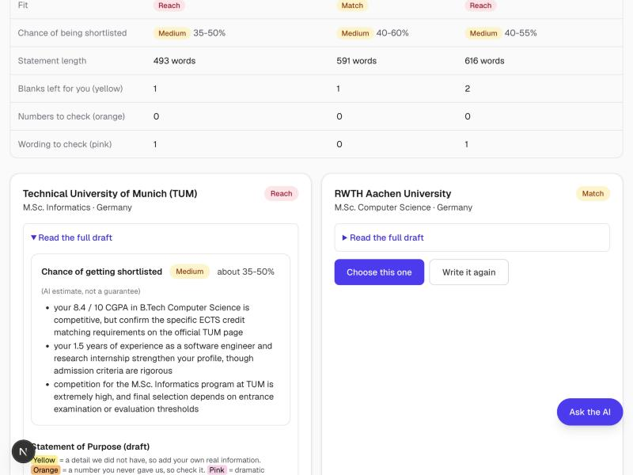 |
| **Chatbot.** It suggests a profile change and the student presses Apply. It never changes anything on its own. | 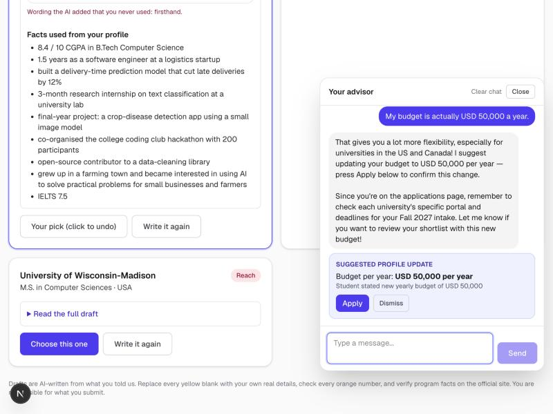 |
| **Scholarships (version 3).** Eligibility match per program, save, and "Ask the AI about this". Version 4 adds rough amount ranges, see below. | 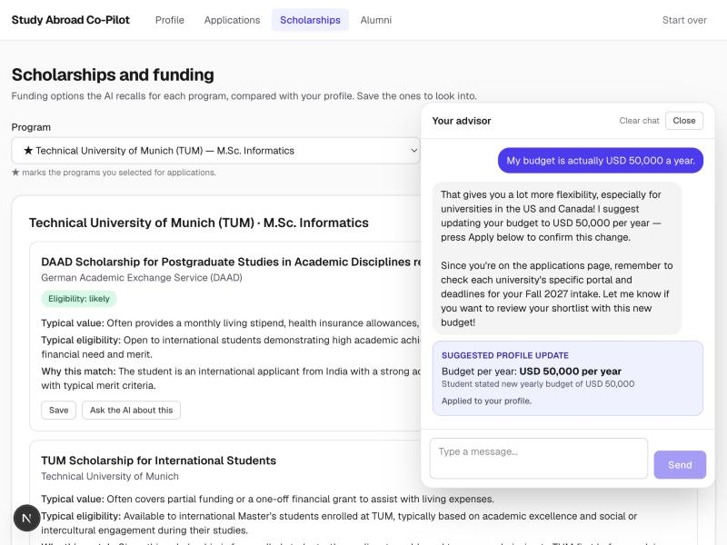 |
| **Alumni paths.** Clearly labelled illustrative, not real people. | 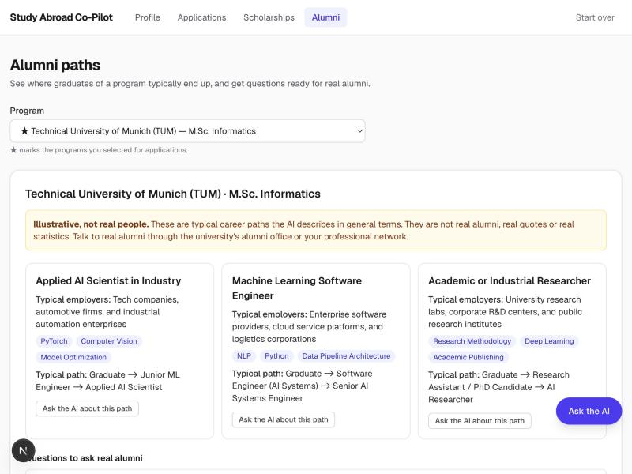 |

### Version 4

| | |
|---|---|
| **Strengths and gaps for one program.** What helps, and each gap with a fix. | 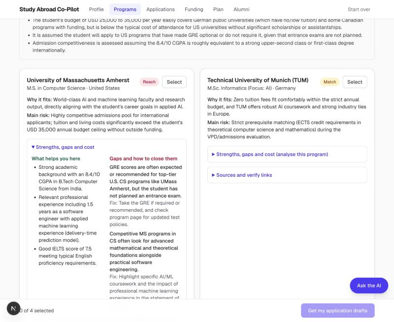 |
| **Cost breakdown.** Tuition and living as ranges, "AI estimate, not a quote", "Over your budget" with the gap and the loan payment on it (worked out by code). | 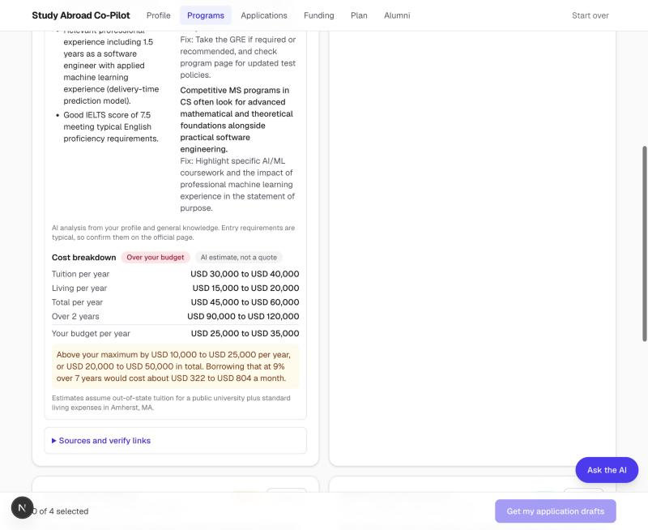 |
| **Compare table** for three selected programs: fit, length, tuition, living, total, against budget, loan payment on any gap. | 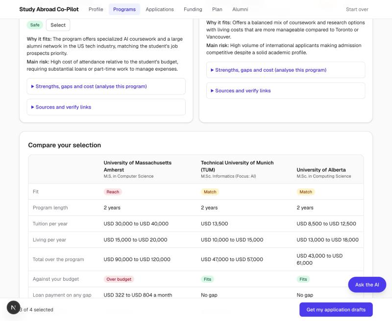 |
| **Plan checklist.** 16 tasks for Fall 2027. Typical dates say "not an official date". The student ticks tasks and confirms dates, and progress updates. | 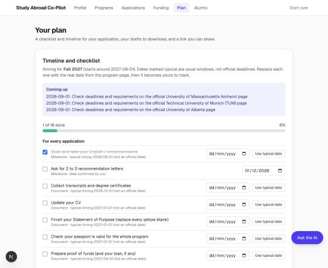 |
| **Shared plan opened with no saved data.** Read-only, name left out. | 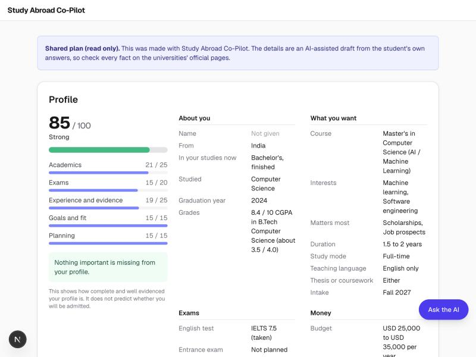 |
| **A damaged share link.** A plain message and a way back, no crash. | 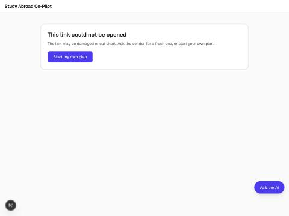 |
| **Funding range slider.** Raising the lower end regrouped the list: 1 within range, 3 outside. Amounts are labelled AI estimates. | 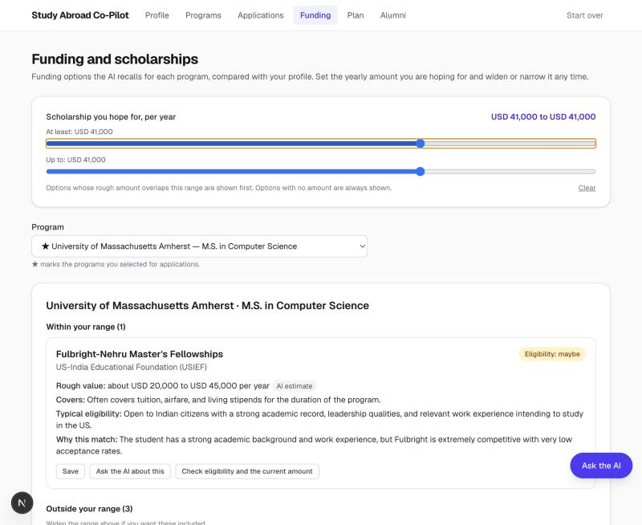 |
| **Phone width.** Guided intake at 375 px, with option chips. | 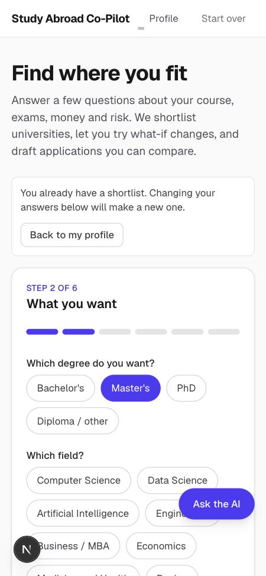 |

## Timeline

1. **Plan, then build.** Wrote a plan first (user journey, files, where AI is used, how each test is checked). Built a one-screen MVP: form → follow-up questions → shortlist → one application.
2. **First real AI run.** Blocked at first because the key saved was an OpenRouter key, not a Gemini key. It was caught by checking the key's format (never printed), and was never sent to the wrong service. The provider was switched from Claude to Gemini by the user's choice.
3. **Test review found a failure.** Test 3 and Test 2 passed. Test 1 failed: with the full sample profile the shortlist ran 104 seconds and was cut off. Root causes: the AI's "thinking" used up the output budget, and the full model was slow (30 to 104 seconds per call).
4. **Fixes.** Thinking turned down and the limit raised. The AI is now told today's date (it had suggested past intake years). A rule that facts about universities are worded as "typically... confirm on the official page". Automatic retries on Google "busy" errors. A check that rejects a nonsense field (once the country came back as "Safe").
5. **Switched to the lite model.** Same shortlist: 3 to 4 seconds in a first test against 40 to 104 seconds. All three tests then passed in the browser. Two quality slips from the faster model were caught and fixed: a very selective school labelled "Safe", and statements under the 500-word target.
6. **Version 3 (this repo).** A multi-page journey: guided intake, profile with what-if sliders, 3 or 4 drafts to compare, a chatbot on every page, scholarships, alumni paths, and the loan calculator.
7. **Bugs found by testing the new version, and fixed.**
   - The chat said "I've updated your budget" when nothing had changed yet. Now it only suggests, and the student must press Apply.
   - Scholarships quoted specific amounts that may be outdated. Amounts are no longer allowed, and the badge now says "Eligibility", so it is not read as "likely to win".
   - A saved duration of "2 years" showed as blank in a dropdown that did not list it.
   - What-if answers sometimes came without a reason for the dropped program (3 of 4 runs). Now every added or dropped program must have a reason, or the answer is rejected and retried.
   - What-if rebuilt the whole list and reshuffled programs, and one reason contradicted itself. Redesigned: the AI only names additions and drops, and the code builds the new list. Drops are only allowed when something that can rule a program out has changed. Reasons that look like leaked reasoning are rejected.
   - The shortlist could ignore the risk setting. Code now checks the Reach/Match/Safe mix and retries.
   - AI drafts sometimes added dramatic wording the student never used ("witnessed firsthand"). Added a prompt rule and a pink highlight as a backstop.
   - A retry loop could run past the 60 second hosting limit. No retry now starts after 25 seconds.
   - Running `npm run build` while the dev server was running made pages hang on "Loading...". Documented in the README.
8. **Submitted, then found the live link had no key.** The Vercel project had no `GEMINI_API_KEY`, so every AI step on the submitted link failed with a message that named `.env.local`. The message is now friendly in production, and `/api/health` and `scripts/verify-deploy.sh` make the problem visible in one command.
9. **Version 4.** A richer intake (6 steps, mostly option chips, ranges, score and grade checks), a profile strength score, strengths and gaps, a cost breakdown and compare table, funding ranges, a plan page with checklist, calendar file, PDF and Word export and a share link, and a design and phone pass. Plan first, approved, then built.
10. **Bugs found while testing version 4, and fixed.**
    - The profile page crashed when opening data saved by version 3 (a list field was missing). Saved and shared data now go through one cleaning step, with a regression test.
    - The chat did not know the new pages, and described the Plan page as the shortlist page. The prompt now says what each page is for. Re-asked after the fix, it described the checklist, downloads, calendar file and share link correctly.
    - The chat button appeared on a shared plan, for a stranger with an empty profile. It is hidden there, and the wording on a shared plan no longer says "your profile".
    - Two open tabs share one saved copy, and a fresh tab with nothing saved overwrote it. This is a limit of having no accounts, now listed in the README.
    - Grounding could not be tested: Google refused the search tool on the free key (error 429). Built the "verify links" fallback and left grounding off rather than claim something unverified.

11. **Version 5: OVEREASE.** Renamed, redesigned and extended after the live link was submitted.
    - Risk became a range (two handles, presets, shortlist rules for a spread). Old single-risk data converts on load, and the what-if only allows drops when the top of the range comes down.
    - Every price shows in USD and INR, with the sample rate stated.
    - The chat became the OVEREASE voice guide with 11 languages.
    - A sidebar journey with ranks, a trip strip, a phone tab bar, and a rebuilt landing, profile, programs, applications and plan.
12. **Bugs found while building version 5, and fixed.**
    - Making risk a range broke three existing tests. The old tests only changed the single `risk` field while the range still applied, so I updated them to change the whole range, and added tests for the new rules.
    - Describing a risk change produced three lines for one change. It now reads as one line.
    - A Hindi sentence about a risk range came back as a single "high" instead of a range. The prompt now says when to use the range fields, and the same sentence then produced a correct lowest and highest pair.
    - shadcn added an unvetted package called `cn`. I replaced it with `clsx` and `tailwind-merge`.
    - On phones the OVEREASE button covered the "Get my application drafts" button. It now floats above the action bar.

## Measured results (manual runs, live API)

| Check | Result |
|---|---|
| What-if: raise budget to USD 60,000 and set risk to High, 4 runs | All 4 gave at least 2 Reach programs, one or two additions, and a reason for each. About 3 seconds each |
| What-if: an irrelevant change, 4 runs | 0 programs added or dropped in all 4 |
| What-if: cut the budget to USD 15,000 | Expensive US and Canadian programs dropped and German ones added, with reasons. Two of four runs were stopped by Google's rate limit, which the app reports in plain words |
| 6 application drafts requested at once | All finished within 24 seconds. Statements were 492 to 590 words. No invented numbers. One flagged wording ("firsthand") |
| Scholarships, 3 runs | No specific amounts in any run |
| Alumni, 2 runs | No names, quotes, salaries or statistics |
| Chat: new fact / general question / "what if" question / instruction hijack | Suggested a change only for the new fact. No change for the others. The system prompt was not revealed |
| Version 4, sample profile (local, live API) | Profile strength 85 of 100 (21/15/19/15/15), matching a hand calculation in the tests. IELTS 11 refused with a red message |
| Version 4, strengths, gaps and cost for one program | About 10 seconds. Cost shown as a range with the gap and loan payment worked out by code |
| Version 4, compare table for 3 programs | Two programs analysed in one click, about 10 seconds |
| Version 4, three application drafts | All three written. 565, 548 and 530 words. One blank each, 0 to 1 pieces of wording to check |
| Version 4, funding lookup for one program | About 25 seconds. Slider change regrouped the list instantly without another AI call |
| Version 4, share link with a chosen draft | 6,266 characters. Opened with no saved data, read-only, name left out. A damaged copy showed the "could not be opened" page |
| Version 4, exports | Calendar file valid (one confirmed date, one event). Word file is a real .docx with 1 yellow highlight, matching the 1 blank in that draft |
| `scripts/verify-deploy.sh` against the local server | 14 of 14 checks passed |
| OVEREASE, typed question in Hindi and Tamil | Both answered in the right script. A made-up language name safely fell back to English |
| OVEREASE, a Hindi sentence stating a budget | Proposed `budgetUsd` 50000 as a number. Applying is still the student's choice |
| OVEREASE, a Hindi sentence naming a risk range | Proposed lowest `balanced` and highest `high` after the prompt fix |
| Version 5, 390 px wide | No sideways scrolling on the ten pages measured |

## What is not proven yet

- **Speech.** The microphone and spoken replies were not tested with real speech. Only typed questions were tested.
- **Lighthouse above 90** has not been measured.
- **The new design on a real phone**, and with a screen reader, has not been checked.

- **Grounding with source links** has not run against the real service (see above). Nothing in the app claims a figure was checked.
- **Version 4 is not deployed**, and the live site cannot make AI calls until `GEMINI_API_KEY` is added in Vercel. After that, `scripts/verify-deploy.sh <live address>` is the test.
- The PDF print window, the calendar file inside a real calendar app, the Word file opened in Word, and a real phone were not checked.
- Facts, costs and scholarship amounts come from the AI's memory and are estimates. Strengths and gaps, and the chance estimate, are AI judgement.
- The what-if change (drop gating and the leaked-reasoning filter) is covered by unit tests and was exercised in earlier live runs, but not re-run in version 4.
- The quota is open: anyone with the live link can use the key. A spend limit in Google's console is the protection.
- No automated browser tests.
